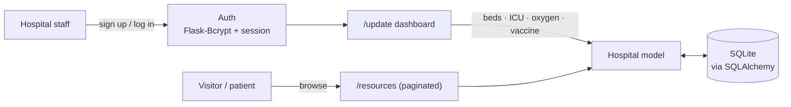
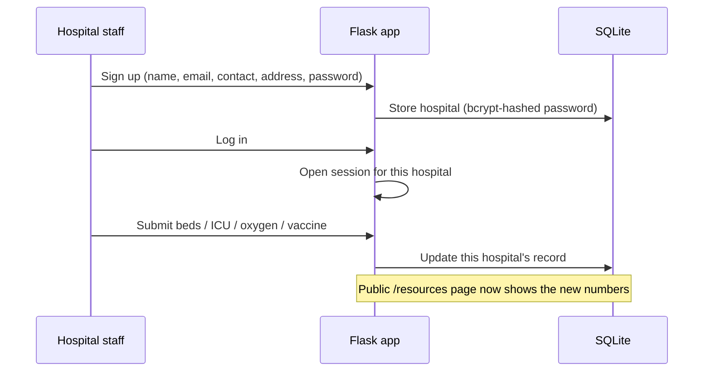

# Hospital Resource Tracker

A Flask web app that lets hospitals publish **live capacity** — available beds,
ICU beds, oxygen, and vaccine doses — so patients and families can find care
fast during a surge. Built during the COVID-19 second wave, when the hardest
part of getting treatment was simply *knowing where capacity existed*.

<p>
  
  
  
  
  
</p>

**Use case.** A city-wide capacity board for surge response: each hospital
publishes beds / ICU / oxygen / vaccines; patients see who can take them
*this hour*, not yesterday.


---

## Why it matters

During a health emergency, capacity changes by the hour. This app gives each
hospital a simple dashboard to keep its numbers current, and gives the public a
single paginated view of **who has what, right now** — no phone tree required.

## Features

- **Hospital accounts** — sign up and log in with passwords hashed via
  `Flask-Bcrypt` (never stored in plain text).
- **Live resource editing** — each hospital updates its beds, ICU beds, oxygen,
  and vaccine counts from one form; changes persist to the database instantly.
- **Public availability board** — a paginated directory (4 hospitals per page)
  anyone can browse to find open capacity.
- **Session-guarded pages** — the update dashboard is only reachable once a
  hospital is logged in.

## Architecture



## How a hospital uses it



## Tech stack

| Layer | Choice |
| ----- | ------ |
| Web framework | Flask |
| ORM / database | Flask-SQLAlchemy + SQLite |
| Auth | Flask-Bcrypt password hashing + Flask sessions |
| Templates | Jinja2 + Bootstrap |

## Data model

```
Hospital
├── name, email (unique), contact (unique), address
├── password        bcrypt hash
└── beds · icubed · oxygen · vaccine   (integers, default 0)
```

## Quickstart

```bash
python -m venv venv && source venv/bin/activate
pip install -r requirements.txt

# the Flask app object lives in the Coronaweb package (__init__.py)
export FLASK_APP=Coronaweb
flask run
```

On first run the SQLite database (`site.db`) is created from the `Hospital`
model. Open the app, create a hospital account, then update your live resource
counts from the dashboard.

## Project structure

```
__init__.py            Flask app, SQLAlchemy + Bcrypt setup (Coronaweb package)
models.py              Hospital table definition
routes.py              home / login / sign-up / resources / update / logout
index1.html            landing page
login.html             hospital login
signup.html            hospital registration
hospitals.html         public, paginated availability board
resources_input.html   logged-in resource-update form
```

## Screenshots


